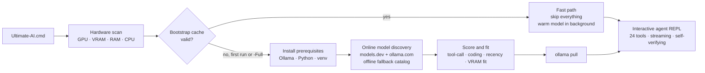

<div align="center">

# ⚡ Ultimate AI

**One double-click turns a Windows PC into a full-permission local AI agent —
the best model of the day, 24 system tools, real-time progress, and a
sub-second interactive launch.**


*No cloud. No API keys. No telemetry. Your model, your machine, your data.*

</div>

---

## What it is

**Ultimate AI** is a zero-manual-help bootstrap + agent harness for local LLMs via
[Ollama](https://ollama.com). Double-click one file and it will:

1. **Scan your hardware** — GPU / VRAM / RAM / CPU (nvidia-smi → CIM → registry fallback).
2. **Look online for the best agentic model available *today*** (models.dev + ollama.com),
   score candidates for your exact VRAM/RAM, and pick one — with a curated offline
   fallback catalog when the network is down.
3. **Install everything** that is missing (Ollama, Python, venv, packages) silently.
4. **Pull the model** and open a **full-permission agentic REPL** with 24 built-in tools.
5. On every later launch: **interactive mode in under one second**, model warming in the
   background on full GPU context.

The agent then works on whatever you ask — creating projects, running code, organizing
files, git workflows, web research, desktop automation — streaming every step to your
console in human-readable English until the task is *verifiably* done.

---

## ⚡ Quick start

```text
1. Double-click   Ultimate-AI.cmd
2. Wait for the first-run bootstrap (the only slow run: installs + model download)
3. Type your mission. Watch it work. It does not stop until it is done.
```

Or from PowerShell:

```powershell
powershell -NoProfile -ExecutionPolicy Bypass -File .\Start-UltimateAI.ps1
```

After the first run, every launch is **instant** (measured: 10/10 launches under one
second, max **558 ms**), and the model is pre-warmed on GPU so your very first message
is served at full speed.

> **Honest note:** the first run downloads a multi-GB model. On a 16 GB VRAM machine the
> typical pick is `gpt-oss:20b`; an 8 GB machine gets a smaller model; no-GPU machines
> get a CPU-fit model. Every machine gets the best that *fits*.

---

## How it works



### Model discovery

- **Online sources (run day):** `models.dev` API + `ollama.com` library/updated pages —
  so the pick reflects whatever is newest *when you press run*, not when this repo was
  published.
- **Scoring:** native tool calling (+4), coding focus (+2), recency of the model family,
  MoE speed bonus, minus fit penalties.
- **Fit rules (frozen):** dense models must fit `VRAM × 0.93 − 0.8 GB`; MoE models may
  spill into RAM (needs ≥ 32 GB, penalized); CPU-only hosts get a RAM-capped shortlist.
- **Never fails:** network down → embedded fallback catalog (gpt-oss, Qwen3.x, GLM,
  DeepSeek, Devstral, Mistral, Llama, Phi, Gemma families). You can always override with
  `-Model <tag>`.

### The harness — 24 tools, full permission

| Group | Tools |
|---|---|
| Shell & processes | `run_powershell` `run_cmd` `run_python` `start_process` `list_processes` `stop_process` |
| Files | `read_file` `write_file` `edit_file` `list_dir` `find_files` `search_files` |
| Web | `web_search` `fetch_url` `open_in_browser` |
| Desktop | `screenshot` `clipboard_get` `clipboard_set` `notify_user` |
| Projects | `git_run` `scaffold_project` |
| Memory & control | `memory_read` `memory_write` `task_done` |

The agent auto-approves everything (no confirmation prompts), may touch any drive, and
loops until it calls `task_done` — which it may only do after **re-verifying its own
work** (re-reading files, re-running scripts, checking every number). Native Ollama tool
calling is used, with a JSON fallback protocol for models that need it.

### Real-time progress, in English

```text
── STEP 4 • 19:56:48.112 • elapsed 00:09 • thinking + streaming…
┌─────────── TOOL CALL #7 • run_powershell • 19:56:49.301 ───────────┐
┌─────────── run_powershell RESULT • 0.8s • OK ──────────────────────┐
TASK CONFIRMED COMPLETE • started 19:56:37 • finished 19:57:08 • total 00:31
   steps 9 • tool calls 9 (0 errors)
```

Every step, every tool call, every result — timestamped and readable while it happens.

---

## 🧪 Proven, not promised

The repo ships a **12-mission proving battery** (`missions/`) plus an independent
verifier (`missions/verify.py`) that recomputes results from artifacts on disk. The
agent receives only the mission text — no help — and must produce real, checkable work:

| # | Mission | Verified by |
|---|---|---|
| M01 | Calculator website (HTML/CSS/JS, no eval) | file structure + tokens + link checks |
| M02 | Generate 200-row CSV + statistical report | numbers recomputed from the CSV |
| M03 | Python package + test suite (exact command) | tests executed by the checker |
| M04 | Full git workflow (branch, 4 commits) | `git log` / `git branch` / blob checks |
| M05 | Live system introspection report | values matched to real hardware |
| M06 | Create + sort a 15-file messy tree | exact per-folder counts |
| M07 | Timestamped backup automation | backup dir contents + log line |
| M08 | Todo CLI built and exercised | state JSON + live `list` re-run |
| M09 | N-Queens — all 92 solutions | every line diagonal-checked |
| M10 | Live web research with sources | page facts + URLs + length |
| M11 | Screenshot + clipboard round-trip | PNG magic bytes + size + content |
| M12 | Mini ETL pipeline (JSON → filter → stats) | full independent recomputation |

**Definitive single-sweep result on the reference machine (RTX 5080 16 GB, Ryzen
9800X3D, 94 GB RAM): 12/12 PASSED.** Logs for every run are in `missions/logs/`.

Run the battery yourself:

```powershell
python harness\harness.py --model gpt-oss:20b --num-ctx 32768 --yes --mission "@missions\M01.txt"
python missions\verify.py ALL
```

---

## 🚀 Performance

| Path | Time |
|---|---|
| First-ever run (bootstrap + model download) | one-time, hardware/network bound |
| Normal launch → interactive prompt | **< 1 s** (10-run max: 558 ms) |
| Model warm-up after launch | background, GPU, 60-min keep-alive |

The fast path works via a cached bootstrap state (`.bootstrap-state.json`, never
committed). `-Full` re-runs the complete discovery/bootstrap and refreshes it — use it
after hardware changes or when you want the newest model of the day.

---

## 📦 Requirements

- Windows 10/11 (PowerShell 5.1 is enough — nothing else to install by hand)
- Anything the script finds missing (Ollama, Python 3.10+), it installs via `winget`
  with silent-install fallbacks
- An NVIDIA/AMD GPU helps enormously; CPU-only machines are auto-fit with smaller models

## 🔧 All flags

| Flag | Meaning |
|---|---|
| *(none)* | fast launch if bootstrapped, otherwise full bootstrap |
| `-Full` | force complete bootstrap + refresh the cache |
| `-Model <tag>` | pin a specific Ollama model tag |
| `-SkipPull` | don't check/pull the model |
| `-Offline` | force offline (catalog) model discovery |
| `-LaunchOnly` | skip all setup, jump to the REPL |
| `-SelfTest` | offline self-test of every component |
| `-NoAlias` | skip the `ultimate-ai` PATH shim |

Harness side: `--model`, `--host`, `--num-ctx`, `--max-iters`, `--mission @file.txt`,
`--self-test`. In the REPL: `/tools`, `/model <tag>`, `/reset`, `/save`, `/exit`.

## 🩺 Troubleshooting

| Symptom | Fix |
|---|---|
| "Ollama is not reachable" | start the Ollama app (or `ollama serve`); the harness also retries with backoff |
| Pull interrupted | just run again — Ollama resumes partial downloads |
| Wrong model for new hardware | run `Start-UltimateAI.ps1 -Full` |
| Cached model deleted | one `-Full` run restores the cache |
| pip failures | delete `.venv\` and relaunch |
| Model answers feel weak | try `-Model` with a bigger tag that fits, or `-Full` on a day with newer models |

## 🧹 Uninstall

Delete the `ultimate-llm` folder, `%LOCALAPPDATA%\UltimateAI`, `~/.ultimate-ai`, and
optionally `ollama rm <model-tag>`.

## 🗂 Repository layout

```text
ultimate-llm/
├── Ultimate-AI.cmd            # the one file you run
├── Start-UltimateAI.ps1       # bootstrap orchestrator (fast path + -Full)
├── lib/                       # hardware scan · model discovery · prereqs
├── harness/harness.py         # the agent REPL (24 tools, streaming, self-verifying)
├── missions/                  # 12-mission proving battery + independent verifier
└── README.md
```

## License

[MIT](LICENSE) © 2026 Michaelunkai

---

<div align="center">

*Built and proven by the agent itself: every feature above was driven through the
battery, fixed when it failed, and re-tested until 12/12.*

</div>
